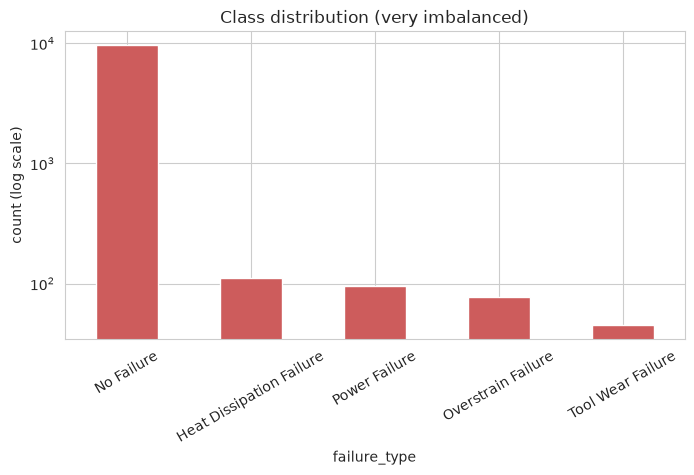
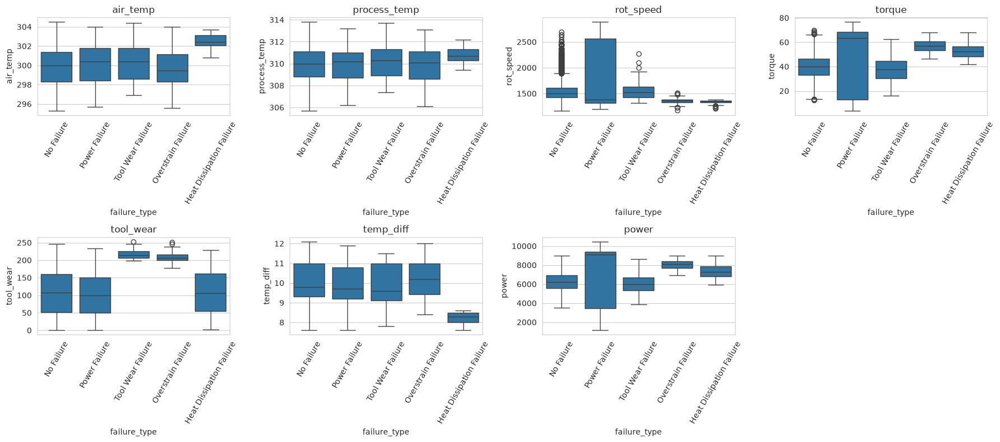
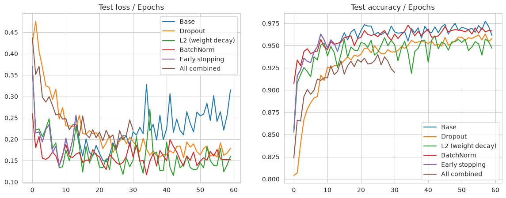

# Lab 1 : DNN / MLP with PyTorch – Deep Learning

<p align="center">
  
  
  
  
</p>

**Goal:** get familiar with PyTorch by building DNN/MLP models for a **regression** task and a **multi-class classification** task, pick the hyper-parameters with `GridSearchCV`, and try some regularization techniques.

## Folder structure
| File / Folder | Description |
|---------------|-------------|
| `notebooks/part1_regression_nyse.ipynb` | Part 1 : regression on the NYSE dataset (stock prices). |
| `notebooks/part2_classification_maintenance.ipynb` | Part 2 : multi-class classification (predictive maintenance). |
| `dataset/` | Datasets (see *Datasets* below). |
| `figures/` | Plots exported from the notebooks and used in this report. |
| `README.md` | This file (the report). |

## Datasets
- Part 1 : Kaggle – [New York Stock Exchange](https://www.kaggle.com/datasets/dgawlik/nyse)
- Part 2 : Kaggle – [Machine Predictive Maintenance Classification](https://www.kaggle.com/datasets/shivamb/machine-predictive-maintenance-classification)

`predictive_maintenance.csv` and `securities.csv` are included. The NYSE price files are too big for GitHub (~50 MB each), so you need to download them:
```bash
kaggle datasets download -d dgawlik/nyse -p dataset/nyse --unzip
```

## How to run
```bash
pip install -r ../requirements.txt
cd notebooks
jupyter notebook
```
Paths are relative (`../dataset/...`). I ran everything on CPU. To use `GridSearchCV` with a PyTorch model I used **skorch**, which wraps an `nn.Module` into an sklearn estimator.

---

## Part 1 : Regression (NYSE)

**Dataset:** prices of 501 S&P 500 companies from 2010 to 2016 (851 264 rows, no missing values).

### 1. Exploratory Data Analysis
- `open`, `close`, `low` and `high` are almost 100% correlated. Predicting the close of the same day from these columns would be too easy (it's basically cheating).
- So I picked a more realistic task: **predict tomorrow's close price of Apple (AAPL) from the last 10 closing prices.**
- The train / test split follows **time order** (first 80% of the days for train, last 20% for test). The scaler is fitted on train only.


### 2. Architecture
MLP: `10 inputs -> hidden layers (Linear + ReLU) -> 1 output`, loss = MSE.

### 3. GridSearch
24 combinations tested with `TimeSeriesSplit` (3 folds):

| Parameter | Values |
|---|---|
| hidden layers | (32), (64, 32), (128, 64, 32) |
| optimizer | Adam, SGD |
| learning rate | 0.01, 0.001 |
| epochs | 50, 100 |

**Best:** Adam, lr = 0.01, hidden = (64, 32), 100 epochs. Adam was in all the top results; SGD was too slow to converge in that many epochs.

### 4. Loss / Epochs and Accuracy / Epochs
Regression has no real "accuracy", so I used the **R² score** instead (1 = perfect).


- Both losses go down, and the test loss stays a bit above the train loss. It doesn't go up at the end, so no big overfitting.
- The curves have a lot of spikes because lr = 0.01 is a bit high.
- Train R² ≈ 0.99, test R² around 0.9.


**Test result:** R² = 0.949, RMSE = 1.81 dollars.
But a naive rule "tomorrow = today" gets RMSE = 1.68 dollars. So the network didn't really learn to predict the market, it mostly copies the last price (the orange line is the blue one shifted by one day). That's expected: stock prices behave a lot like a random walk.

### 5. Regularization
| Model | RMSE (dollars) | MAE | R² |
|---|---|---|---|
| **Base** | **1.81** | **1.31** | **0.949** |
| Dropout (0.2) | 3.46 | 2.98 | 0.812 |
| L2 / weight decay (1e-4) | 2.08 | 1.52 | 0.932 |
| BatchNorm | 1.90 | 1.43 | 0.943 |
| Early stopping (patience 10) | 1.94 | 1.41 | 0.941 |
| All combined | 2.44 | 1.90 | 0.907 |


- None of them beat the base model. The model is small and doesn't overfit much, so there's nothing to fix.
- Dropout is the worst: it adds noise, and regression needs precise outputs.
- Early stopping gets almost the same score but stops at epoch 37 instead of 100.

---

## Part 2 : Multi-class classification (Predictive Maintenance)

**Dataset:** 10 000 machines with 5 sensor values (air temperature, process temperature, rotational speed, torque, tool wear) and a product type (L / M / H). Target = `Failure Type`.

### 1. Pre-processing
- No missing values, no duplicates.
- Dropped `UDI` and `Product ID` (just IDs).
- Found **27 inconsistent rows**: 9 rows with `Target = 1` but "No Failure", and the 18 "Random Failures" rows which all have `Target = 0`. I removed them, so 5 classes are left.
- Dropped `Target` because it gives away the answer (data leakage).
- Added 2 features that make physical sense: `temp_diff = process_temp - air_temp` and `power = torque × rotational speed`.
- One-hot encoding for `Type`, `LabelEncoder` for the classes, `StandardScaler` fitted on train only.
- Stratified 80% / 20% split.

### 2. Exploratory Data Analysis
The dataset is **very imbalanced**: 96.7% "No Failure", and only 45 "Tool Wear Failure" rows.





The boxplots show some clear rules: Tool Wear Failure when tool wear is high, Heat Dissipation when `temp_diff` is small, Power Failure when power is too low or too high, Overstrain with high torque and high tool wear.

### 3. Data augmentation (SMOTE)
SMOTE creates new samples for the small classes by mixing a real sample with its neighbours from the same class. I applied it **on the train set only** (the test set stays real). Train went from 7 978 to 38 570 rows (7 714 per class).


### 4. Architecture
MLP: `10 inputs -> hidden layers (Linear + ReLU) -> 5 outputs`, loss = CrossEntropy.

### 5. GridSearch
Same grid as part 1 (epochs 30 / 60), scored with **macro F1** because accuracy is misleading here.

**Best:** Adam, lr = 0.001, hidden = (128, 64, 32), 60 epochs (CV macro F1 = 0.97).

### 6. Loss / Epochs and Accuracy / Epochs


- Train loss goes to almost 0 and train accuracy to almost 100%.
- **Test loss goes down until epoch ~8, then goes back up**: that's overfitting, the model starts memorizing the train data (including the synthetic samples).
- Test accuracy stays around 96-97%, but that number doesn't mean much: always answering "No Failure" would also give ~97%.

### 7. Metrics (base model)
| | Train | Test |
|---|---|---|
| Accuracy | 0.980 | 0.961 |
| Precision (macro) | 0.770 | 0.623 |
| Sensitivity / Recall (macro) | 0.996 | 0.854 |
| F1 (macro) | 0.830 | 0.695 |


- Good sensitivity: the model finds most real failures (16/16 Overstrain, 20/22 Heat Dissipation, 16/19 Power).
- Low precision: lots of false alarms, especially 45 normal machines predicted as "Tool Wear Failure".
- Tool Wear Failure is the hardest class (F1 = 0.17): only 45 real examples in the whole dataset.
- For maintenance, a false alarm is less bad than a missed failure, so I think this behaviour is acceptable.

### 8. Regularization
| Model | Train F1 | Test accuracy | Test precision | Test recall | Test F1 |
|---|---|---|---|---|---|
| **Base** | 0.830 | 0.961 | 0.623 | 0.854 | **0.695** |
| Dropout (0.3) | 0.784 | 0.958 | 0.582 | 0.812 | 0.657 |
| L2 / weight decay (1e-3) | 0.735 | 0.947 | 0.564 | 0.869 | 0.653 |
| BatchNorm | 0.885 | **0.966** | 0.616 | 0.777 | 0.675 |
| Early stopping (patience 5) | 0.783 | 0.963 | 0.583 | 0.804 | 0.658 |
| All combined | 0.691 | 0.940 | 0.546 | 0.880 | 0.640 |



- All regularization techniques **fixed the overfitting in the loss**: their test loss stays around 0.15 while the base model goes up to 0.32.
- But none of them improved the test macro F1. BatchNorm comes closest and has the best accuracy.
- L2 and "All combined" catch a few more failures (higher recall) but give more false alarms.
- Early stopping stopped at epoch 14, close to where the base test loss was lowest.
- The real limit here is the tiny number of real failure examples, not the model.

**Notes:** in both parts, early stopping watches the test set; using a separate validation set would be cleaner. Also, in part 2 the GridSearch ran on the SMOTE data, so the validation folds contain synthetic samples (that's why CV F1 = 0.97 is much higher than test F1 = 0.69). Putting SMOTE inside an `imblearn` Pipeline would fix this.

---

## Synthesis – what I learned
- How to build an MLP in PyTorch (`nn.Module`, `nn.Sequential`) and write the training loop myself (forward, loss, `backward()`, `optimizer.step()`).
- How to use `GridSearchCV` with a PyTorch model thanks to **skorch**, and how to pick a cross-validation that fits the data (time order for prices, stratified for imbalanced classes).
- **A good score doesn't always mean a good model.** In part 1, R² = 0.95 looks great but the simple "tomorrow = today" rule does better. In part 2, 96% accuracy means almost nothing when 97% of the data is one class. Always compare with a simple baseline and use the right metric (macro F1, recall, confusion matrix).
- How to avoid data leakage: split before scaling, fit the scaler on train only, apply SMOTE on train only, drop columns that give away the answer.
- How to read Loss / Accuracy curves: spikes mean the learning rate is high, and a test loss going up while the train loss goes down means overfitting.
- Regularization (Dropout, L2, BatchNorm, Early stopping) helps when the model overfits, but it doesn't always improve the final score. When the model is small or the problem comes from the data itself (too few examples), it can't fix everything.

## Author
Made by **EL GORRIM Mohamed** – Cycle Ingénieur LSI
