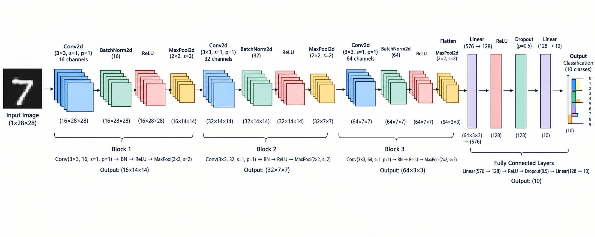
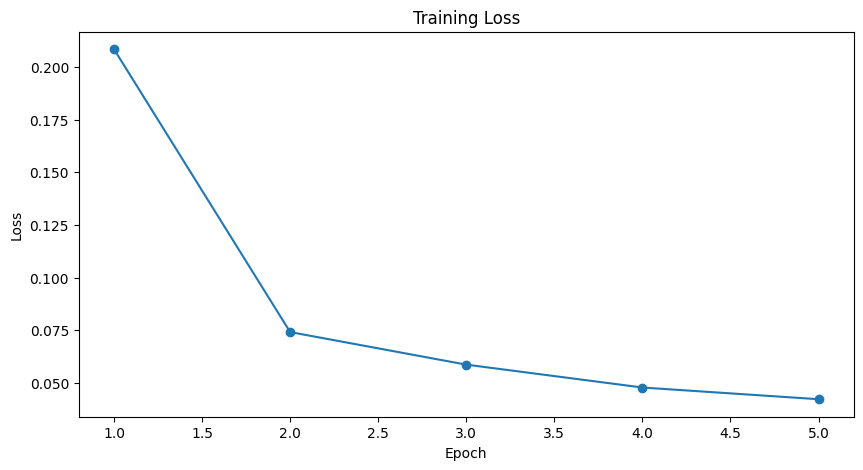
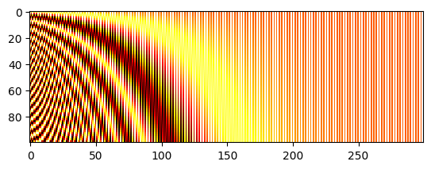
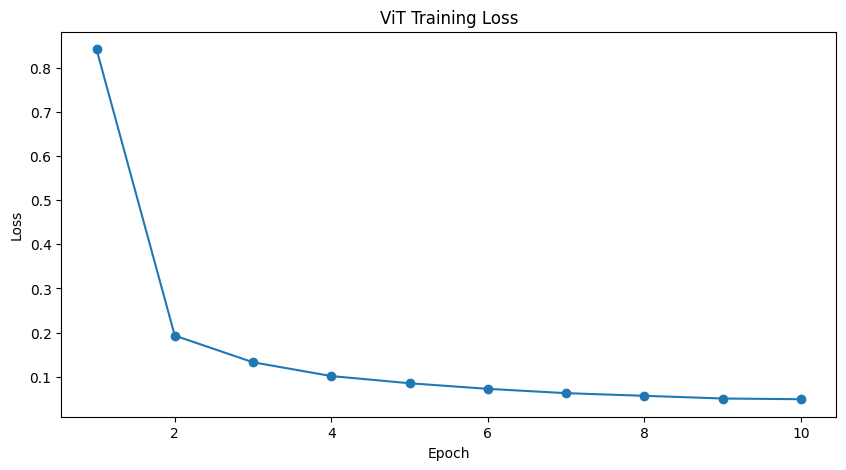
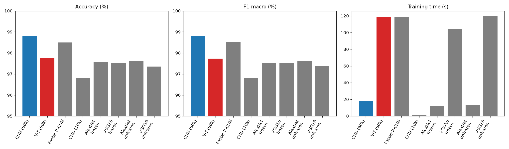

# Lab 2 : CNN, Faster R-CNN, fine-tuning and Vision Transformer – Deep Learning

<p align="center">
  
  
  
  
</p>

**Goal:** classify the MNIST digits with a **CNN** built in PyTorch, a **Faster R-CNN**, fine-tuned **VGG16 / AlexNet**, and a **Vision Transformer (ViT)** written from scratch, then compare them with several metrics (accuracy, F1 score, loss, training time).

## Folder structure
| File / Folder | Description |
|---------------|-------------|
| `notebook/part1_cnn_rcnn.ipynb` | Part 1 : CNN, Faster R-CNN, VGG16 / AlexNet fine-tuning and comparison. |
| `notebook/part2_vit.ipynb` | Part 2 : Vision Transformer from scratch and comparison with part 1. |
| `figures/` | Plots exported from the notebooks and used in this report. |
| `README.md` | This file (the report). |

## Dataset
Kaggle – [MNIST Dataset](https://www.kaggle.com/datasets/hojjatk/mnist-dataset): 60 000 training images and 10 000 test images of handwritten digits (28x28, grayscale, 10 classes). It is downloaded automatically with `kagglehub` and read from the IDX files.

## How to run
```bash
pip install -r ../requirements.txt
cd notebook
jupyter notebook
```
Everything was run with the **Google Colab extension in VS Code**, which gives access to a free **NVIDIA T4 GPU** (CUDA). The notebooks need a GPU runtime, so connect them to a Colab kernel with the T4 selected. Run the cells from top to bottom.

---

## Part 1 : CNN, Faster R-CNN and fine-tuning

### 1. CNN classifier
Pixels are scaled to 0-1 and normalized (mean 0.1307, std 0.3081).



*I generated this diagram with ChatGPT so it may not be 100% accurate. The code in the notebook is the reference. Summary: 3 blocks of Conv (3x3, stride 1, padding 1) + BatchNorm + ReLU + MaxPool (2x2) with 16, 32 and 64 channels, then Flatten, Linear (576 -> 128), ReLU, Dropout (0.5) and Linear (128 -> 10).*

| Hyper-parameter | Value |
|---|---|
| Loss | CrossEntropyLoss |
| Optimizer | Adam, lr = 0.001 |
| Regularization | Dropout (0.5), BatchNorm, weight decay 1e-4 |
| Batch size / epochs | 64 / 5 |
| Device | GPU (Tesla T4 on Google Colab) |

The model has only **0.099 M parameters**. It reaches about **99% test accuracy** (98.99% on the full test set, 98.80% on the 2000 images used for the comparison) and trains in about 18 seconds.



### 2. Faster R-CNN
Faster R-CNN is an **object detector**, but MNIST only has class labels. So I generated one box per image: the bounding box of the pixels that are not background.
- Model: `fasterrcnn_mobilenet_v3_large_fpn` with pretrained weights, new head for 11 classes (10 digits + background, labels are `digit + 1`).
- SGD (lr 0.01, momentum 0.9), images resized to 128x128, **10 000 training images and 2 epochs** (the full dataset would take too long).
- The predicted digit is the label of the box with the best score. If nothing is detected, the image counts as wrong.

### 3. Fine-tuning VGG16 and AlexNet
- Pretrained ImageNet models. Images are repeated to 3 channels, resized to 224x224 and normalized with the ImageNet values.
- The last layer is replaced by `Linear(4096, 10)`.
- Two versions of each: **features frozen** (only the classifier is trained, Adam lr 1e-4) and **last conv block unfrozen** (lr 1e-5 for that block).
- 10 000 training images and 2 epochs, like Faster R-CNN.

### 4. Fair comparison
The first CNN saw 60k images for 5 epochs, but the other models only 10k images for 2 epochs. So I also trained the same CNN on the same 10k images and 2 epochs ("CNN 10k"). All models are tested on the same 2000 test images. Differences smaller than about 0.3% are not significant (1 image = 0.05%).

---

## Part 2 : Vision Transformer (ViT)

The ViT follows the tutorial and is written from scratch:
1. **Patchify**: the 28x28 image is cut into 7x7 = 49 patches of 4x4 pixels, each one flattened (16 values).
2. **Linear mapper**: each patch goes to a vector of size 64.
3. **Class token** added in front of the patches (50 tokens).
4. **Positional embeddings** (sin / cos) added to the tokens.
5. **4 encoder blocks**: LayerNorm, multi-head self-attention (4 heads) with residual, LayerNorm, MLP (GELU) with residual.
6. **Classification head**: a Linear layer on the class token (10 outputs).

| Hyper-parameter | Value |
|---|---|
| Patches / hidden size / heads / blocks | 49 / 64 / 4 / 4 |
| Optimizer | Adam, lr = 0.001 |
| Batch size / epochs | 128 / 10 |
| Training data | all 60k images |
| Parameters | 0.148 M |





---

## Results and comparison

| Model | Setup | Accuracy (%) | F1 macro (%) | Loss | Training time (s) | Params (M) |
|---|---|---|---|---|---|---|
| **CNN** | 60k images, 5 epochs | **98.80** | **98.79** | **0.036** | 17.7 | 0.099 |
| ViT | 60k images, 10 epochs | 97.75 | 97.73 | 0.078 | 119.1 | 0.148 |
| Faster R-CNN | 10k images, 2 epochs | 98.50 | 98.51 | 0.529* | 119.1 | 18.976 |
| CNN (10k) | 10k images, 2 epochs | 96.80 | 96.80 | 0.099 | 1.2 | 0.099 |
| AlexNet | 10k images, 2 epochs, frozen | 97.55 | 97.53 | 0.082 | 12.0 | 57.045 |
| VGG16 | 10k images, 2 epochs, frozen | 97.50 | 97.50 | 0.069 | 104.3 | 134.302 |
| AlexNet | 10k images, 2 epochs, last block unfrozen | 97.60 | 97.61 | 0.077 | 13.4 | 57.045 |
| VGG16 | 10k images, 2 epochs, last block unfrozen | 97.35 | 97.37 | 0.077 | 120.0 | 134.302 |

\* The Faster R-CNN loss is the sum of its RPN and ROI losses, so it can't be compared with the cross-entropy of the others. On the full test set the ViT gets 98.18% accuracy.



### Interpretation
- **The small CNN is the best choice for MNIST.** With all the data it gets about 99% with only 0.1 M parameters and 18 seconds of training.
- **With the same small data** (10k images, 2 epochs), the pretrained AlexNet and VGG16 (about 97.5%) are better than the CNN from scratch (96.8%), because ImageNet features give them a good start. But they have 500 to 1300 times more parameters, and VGG16 is about 90 times slower. Unfreezing the last block did not change much (1 to 3 images out of 2000).
- **Faster R-CNN** gave good accuracy (98.5%) but needs about 100 times more training time than the CNN, and 19 M parameters. It is a detector, and here the boxes had to be generated artificially, so it is not the right tool to classify one centered digit. Its result also changed between two runs (96.35% then 98.50%) because its seed was not fixed.
- **ViT** reaches 97.75% (98.18% on the full test set). It is better than the CNN trained on the same small data and equal to the pretrained models with far fewer parameters, but it stays about 1% below the CNN trained on all data and it is slower (about 12 s per epoch against 3.5 s). A CNN already knows how images work (local filters, the same filter everywhere), while the ViT must learn it from the data, and MNIST is small and simple. ViTs become better with very large datasets or pretraining.

**Notes:** the ViT was trained for 10 epochs and the first CNN for 5. The test subset has only 2000 images, so small differences are not significant. Most models were not seeded (only the CNN, the same-data CNN and AlexNet), so a new run can give slightly different numbers.

---

## Synthesis – what I learned
- How to build a **CNN** in PyTorch (convolution, pooling, fully connected layers), choose its hyper-parameters (kernel size, padding, stride, optimizer, regularization) and train it on the **GPU** by moving the model and the data to `cuda`.
- **Faster R-CNN is made for detection, not classification.** To use it on MNIST I had to create the boxes myself, and the result is heavy and slow for a simple task. Choosing the right model for the task matters more than choosing the biggest one.
- How to **fine-tune pretrained models** (VGG16, AlexNet): replace the last layer, freeze the convolutional part, and use a small learning rate if we unfreeze layers. Pretraining helps when data is small, but for 28x28 grayscale digits the gain is small and the cost (parameters, time) is very large.
- **A comparison must be fair.** My first table was misleading because the models did not have the same data and epochs. Training everything on the same data, testing on the same images, and not trusting differences smaller than the noise (2000 images -> 0.3%) changed my conclusions.
- Use several metrics: accuracy, F1, loss and training time tell different stories (and the loss of Faster R-CNN can't be compared with the others).
- How a **Vision Transformer** works: patches, linear mapping, class token, positional embeddings, multi-head self-attention and encoder blocks. Writing it from scratch helped me understand each step. It works well even with a tiny model, but a CNN is still better and faster on a small dataset like MNIST, because it has the right assumptions about images built in.

## Author
Made by **EL GORRIM Mohamed** – Cycle Ingénieur LSI
