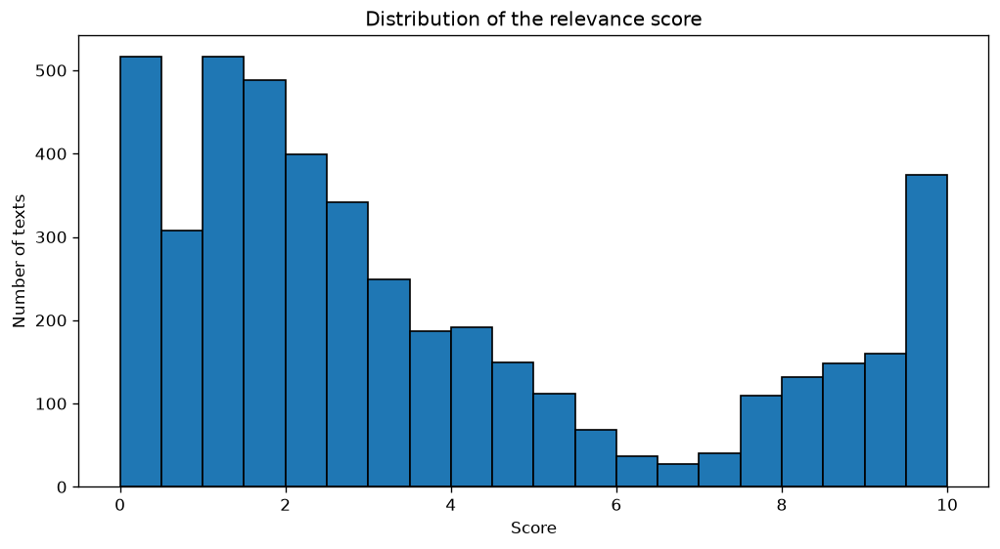
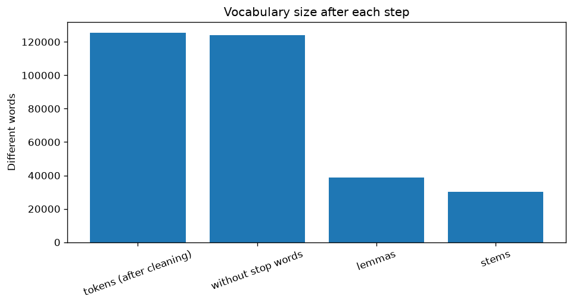
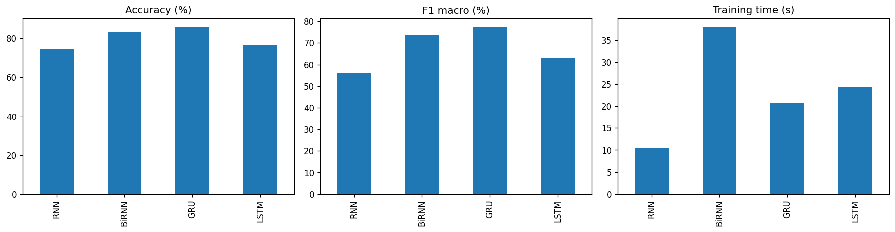
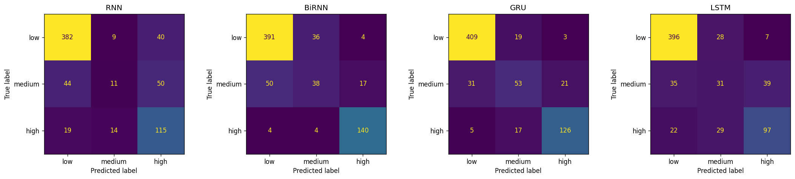
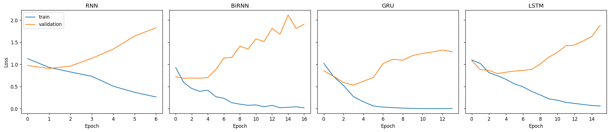
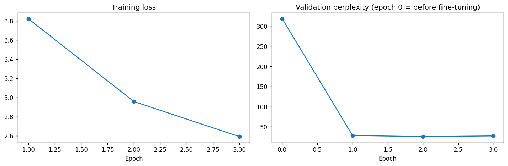

# Lab 3 : Sequence Models (RNN, GRU, LSTM) and GPT-2 – NLP

  

## Goal of the lab
In the first two labs the data was already there: prices, sensor values, images. This time I had to start from nothing and work with **Arabic text**. The lab has two parts. In the first one I build my own dataset by scraping Arabic websites, give each text a relevance score, clean everything with an NLP pipeline, and train four sequence models, a **simple RNN, a bidirectional RNN, a GRU and an LSTM**, to say how relevant a text is to a topic. In the second part I take a pretrained **GPT-2**, fine-tune it on my own articles, and ask it to write a new paragraph from a sentence I give it.

## The dataset and the websites
I chose one topic: **artificial intelligence and technology news**. There are a lot of Arabic articles about it, the vocabulary is clear (ChatGPT, الذكاء الاصطناعي, روبوت...), and the websites mix very different content, so some texts are really about AI and others are not at all. That is what I need to get relevance scores that are not all the same.

My first choice was tech-wd.com, but it is behind a Cloudflare check that refuses scripts. I did not try to get around it and I changed to three other websites. In the end I scraped **4555 articles**:

| Website | Articles | What it is |
|---|---|---|
| [aitnews.com](https://aitnews.com) | 1492 | Tech news, a lot about AI |
| [arabhardware.net](https://arabhardware.net) | 1563 | Hardware, reviews and tech news |
| [aljazeera.net](https://www.aljazeera.net) (tech and ebusiness) | 1500 | General news, so many texts are not about AI |

To get the links I did not click through the pages. I read the **sitemaps** of the websites (the XML files that list their articles, and `robots.txt` allows them). Then I open each article with `requests`, and I keep the title and the text with `BeautifulSoup`, with a pause of half a second between two requests to be polite. I removed the duplicates and the texts shorter than 200 characters. The texts have 5000 characters on average. The scraping takes about 2 hours, so the notebook saves every 100 articles and starts again where it stopped if something goes wrong.

About where it ran: the scraping, the scoring and the preprocessing ran on my laptop, and the **models and GPT-2 ran on a free T4 GPU on Kaggle** (I put their results back in the notebooks). The big intermediate files are not in the repository, the notebooks create them again. `dataset/arabic_texts.csv` is the final scraped dataset.

---

## Part 1 : Classification with sequence models

### 1. The score of each text
The lab asks for a relevance score between 0 and 10, but I cannot read and label 4500 texts by hand. So I made a simple rule, based on keywords:
- I count the **strong keywords** of the topic in the text (الذكاء الاصطناعي, ChatGPT, Gemini, "التعلم الآلي", روبوت, ...) and the **weak** ones (بيانات, معالج, تقنية, ...). A weak keyword counts 0.3.
- I divide by the number of words (so a long text is not favoured) and I add 3 points if the title has a strong keyword.
- The 95th percentile gets 10, and a square root spreads the low scores.

The score is a **heuristic, not a human judgment**. I checked it by reading examples: politics and games get about 0 to 1.5, general tech news about 3 to 5, and articles with AI in the title 9 to 10.

Because the lab also talks about **discretization**, I cut the score into 3 classes: low (0 to 3.5), medium (3.5 to 6.5) and high (6.5 to 10). The classes are not balanced: **2869 low, 700 medium, 986 high**. The website also tells a lot about the class (aitnews is mostly "high", the two others mostly "low"), so the models may partly learn the style of a website.

### 2. NLP pipeline
| Step | What I did |
|---|---|
| Cleaning | Remove links, diacritics and tatweel. |
| Tokenization | Keep the Arabic and English words (numbers and punctuation are dropped). |
| Stop words | Remove the 13 465 stop words of the `Arabic-Stopwords` list. |
| Lemmatization | `qalsadi`: الشركات becomes شركة, يتعلمون becomes تعلم. |
| Stemming | ISRI stemmer: الشركات becomes شرك. |
| Normalization | One form for the letters (أ إ آ to ا, ى to ي, ة to ه), done last because the lemmatizer needs the correct spelling. |
| Vocabulary | Words seen at least 2 times in the train set, `<pad>` = 0 and `<unk>` = 1. |
| Padding | Every text is cut or padded to 300 tokens. |

The vocabulary goes from 124 077 different words to **38 905 lemmas** (30 027 stems), so the models see far fewer different words. I train on the lemmas, they are readable and the stems cut some words badly (نماذج becomes اذج). The dataset is split 70 / 15 / 15 (3188 / 683 / 684 texts), the classes are respected in each part, and the vocabulary (19 847 words) is built **with the train set only**, so nothing leaks from validation and test. Only 1.5% of the words of the test set are unknown.

### 3. Models
The four models have the same structure and only the recurrent layer changes:

`Embedding (100) -> RNN / BiRNN / GRU / LSTM -> last hidden state -> Dropout -> Linear (3 classes)`

Some choices:
- The texts are padded with zeros, so I use `pack_padded_sequence`: the model reads only the real words.
- The loss is `CrossEntropyLoss` with **class weights**, because of the unbalanced classes.
- Adam, batch size 32, gradient clipping (RNN gradients can explode), and **early stopping on the validation macro F1** (patience 5).

**Tuning:** for each model I tried 8 combinations (hidden size 64 or 128, learning rate 0.001 or 0.003, dropout 0.3 or 0.5) and kept the one with the best validation F1. The test set is not used for this.

| Model | Best configuration | Validation F1 |
|---|---|---|
| RNN | hidden 64, lr 0.003, dropout 0.5 | 56.9 |
| BiRNN | hidden 128, lr 0.003, dropout 0.5 | 75.1 |
| GRU | hidden 128, lr 0.003, dropout 0.3 | 81.4 |
| LSTM | hidden 64, lr 0.001, dropout 0.5 | 66.1 |

### 4. Results on the test set
| Model | Accuracy (%) | F1 macro (%) | Loss | Training time (s) | Epochs | Params (M) | BLEU |
|---|---|---|---|---|---|---|---|
| RNN | 74.3 | 56.1 | 0.894 | 10.4 | 7 | 1.996 | 0.856 |
| BiRNN | 83.2 | 73.8 | 1.604 | 38.1 | 17 | 2.044 | 0.948 |
| **GRU** | **86.0** | **77.5** | 1.254 | 20.8 | 14 | 2.073 | 0.968 |
| LSTM | 76.6 | 62.8 | 1.277 | 24.4 | 16 | 2.027 | 0.958 |

- **The GRU is the best**, then the BiRNN, the LSTM and the RNN. The order is the same on the validation set.
- **The plain RNN is the worst.** The texts are long (300 words) and it forgets the beginning of the text, which is the known vanishing gradient problem. The gates of the GRU and the LSTM, and the second reading direction of the BiRNN, fix a part of it. The GRU beating the LSTM is not a rule: a GRU cell is simpler, and with only 3188 training texts it is easier to train.
- **"Medium" is the hardest class** for all the models (the GRU finds 53 of the 105 medium texts, the RNN only 11). It is the smallest class and it sits between the two others.
- **There is a lot of overfitting.** The validation loss is the lowest around epoch 3 or 4, then it goes up while the training loss goes to 0. Early stopping watches the F1 and not the loss, so it keeps a later epoch, and this is why the test loss is high (0.9 to 1.6) even if the F1 is good.
- **More data helped the most.** My first try used 894 texts (and only one combination of hyper-parameters per model) and gave a macro F1 between 45 and 60. With 4555 texts it is between 56 and 78.

**About BLEU:** the lab asks for it, but BLEU compares a generated text to a reference text, so it does not really fit a classification task. Here I compare the sequence of predicted classes with the real ones. The result does not follow the F1 (the LSTM has a better BLEU than the BiRNN but a worse F1; the RNN gets 0.856 with only 56% F1), so I trusted accuracy and macro F1. BLEU is used for real in part 2.

---

## Part 2 : Text generation with GPT-2

Following the tutorial: a dataset class, a training loop with AdamW and a learning rate scheduler, and generation with top-k / top-p sampling. Some choices:
- `pytorch-transformers` is the old name of the library, today it is `transformers`.
- The original GPT-2 only knows English, so I used **AraGPT2** (`aubmindlab/aragpt2-base`, 135 M parameters), which has the GPT-2 architecture and was pretrained on Arabic.
- **My own dataset:** the 1686 articles of my corpus that are medium or high relevance to AI (the classes 1 and 2 of part 1). Each sample is the title and the beginning of the article, 256 tokens at most. 1517 for training and 169 for validation.
- AdamW (lr 5e-5), warm-up, gradient clipping, half precision, 3 epochs, batch size 8. It takes only **156 seconds** on the T4.
- **I switched the dropout off** for the fine-tuning. With the default dropout (0.1), the loss of this model on one batch was 10.6 instead of 6.2 in evaluation mode, so the model was damaged before learning anything. It showed up in a test run, because the training loss looked wrong.

| | Perplexity (lower is better) | BLEU |
|---|---|---|
| AraGPT2 before | 318.0 | 0.0048 |
| AraGPT2 fine-tuned | **27.3** | **0.0131** |

For the BLEU, the prompt is the first 25 words of a validation article, the reference is the next 50 words, and the model writes the continuation without sampling. The values are low because a good continuation rarely uses the same words as the reference, but the fine-tuned model is almost 3 times better.

**Example** (prompt: *أعلنت شركة جوجل عن نموذج جديد للذكاء الاصطناعي*):

Before the fine-tuning:
> أعلنت شركة جوجل عن نموذج جديد للذكاء الاصطناعي يحمل اسم Pew . هذه النسخة الجديدة من الذكاء الاصطناعي توفر للمستخدمين فرصة أكبر للعثور على المعلومات عن الأماكن والأشياء التي يمكن رؤيتها من خلال الصور الفوتوغرافية ...

After:
> أعلنت شركة جوجل عن نموذج جديد للذكاء الاصطناعي يحمل اسم Gemini 4، وذلك خلال مؤتمر Google I/O 2026. ... وتأتي هذه الخطوة في إطار خطط الشركة لطرح أدوات جديدة للذكاء الصناعي، مع توسيع نطاق استخدام هذه الأدوات لتشمل هواتف أندرويد ...

- **The style changed a lot.** Before, the model writes old-style text (Android 4.4, Symbian, old phones). After, it writes like a modern tech news site with the right words.
- **But it does not know facts.** In one text it says that OpenAI belongs to Elon Musk, it invents names and numbers, and it sometimes mixes subjects. A few characters are broken because the tokenizer works on bytes and can cut an Arabic letter. The text sounds right but cannot be trusted.
- **The third epoch already overfits** a little: the validation perplexity is 28.3, 25.6 and 27.3 after the three epochs, so 2 epochs would have been better.

---

## Synthesis – what I learned
- **Scraping** with `requests` and `BeautifulSoup`: reading the sitemaps is much better than clicking through the pages, because it gives clean lists of links. I also learned to respect `robots.txt`, to wait between requests, to save often so a crash does not cost hours, and that some websites simply refuse scripts.
- **Labelling is the hard part of a dataset.** I could not label thousands of texts by hand, so I built a score from keywords. It works, but it means the models can learn the rule instead of the meaning, and I must say it in the report. Choosing how to label a dataset is as important as choosing the model.
- **Arabic needs its own preprocessing:** diacritics, tatweel, many forms of the same letter, and words stuck to prefixes (والشركات, للبورصة). Lemmatization gives readable and good words, the ISRI stemmer cuts too hard. Normalization must come after the lemmatizer, not before. I also built the vocabulary with the train set only.
- **RNN, GRU and LSTM:** the plain RNN struggles with long texts, and gates and bidirectional reading help a lot. Padding must be handled (`pack_padded_sequence`), unbalanced classes need class weights and macro F1, and I should not trust accuracy alone.
- **Tuning and overfitting:** the validation set is for choosing, the test set is for the final number. The curves show that the validation loss goes up long before the F1 stops improving, so what I stop on matters.
- **More data beats more tuning.** Going from 894 to 4555 texts improved the models much more than the hyper-parameters.
- **BLEU is not a magic metric:** it is useful for generated text and meaningless for classification, so the metric has to fit the task.
- **Fine-tuning GPT-2:** a pretrained language model adapts to a new style with only 1500 articles and 3 minutes of GPU. The perplexity (318 to 27) is a good way to measure it. But the model learns the style, not the facts, so it invents things, and the generated text needs a human check. Small details like the dropout can break a pretrained model, so I should always look at the first loss values.
- **GPU work:** I used the free T4 GPU of Kaggle for the models and for GPT-2, and ran everything else locally.

## Author
Made by **EL GORRIM Mohamed** – Cycle Ingénieur LSI
