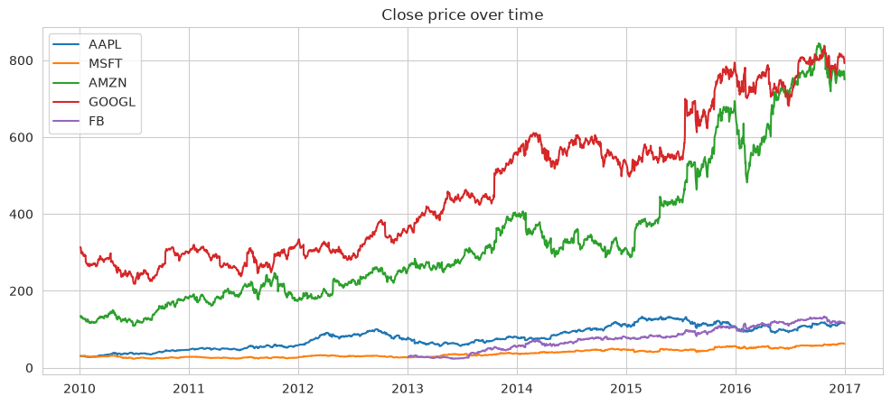
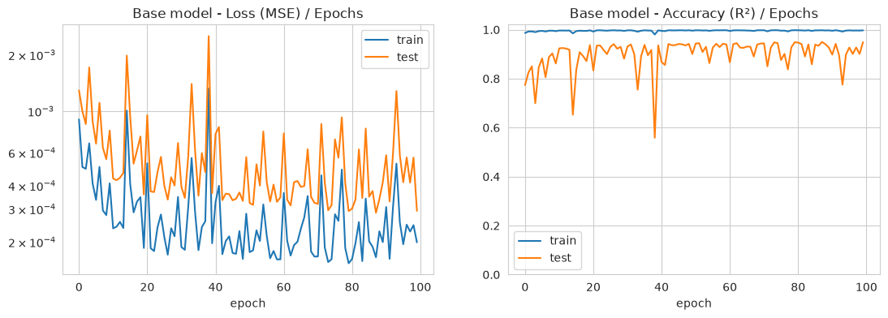
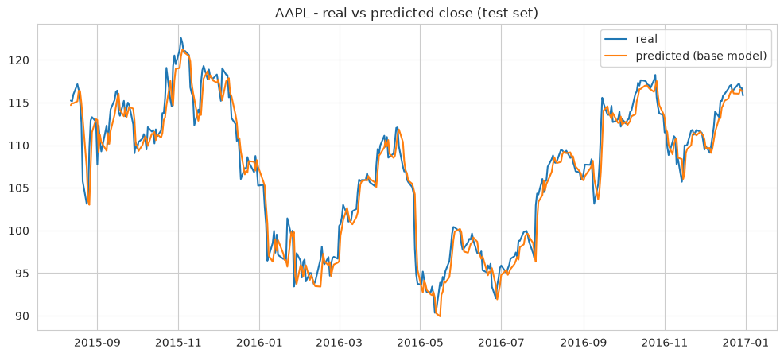
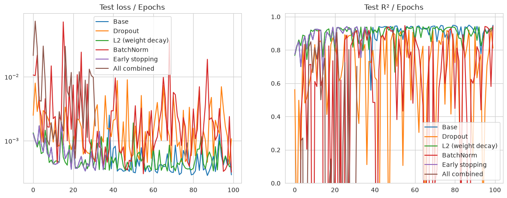
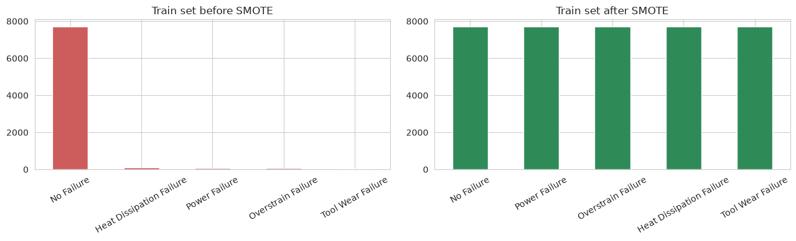
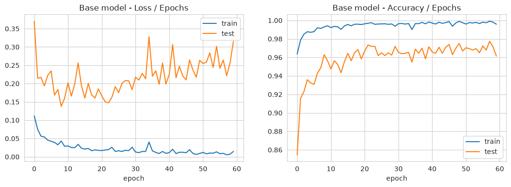
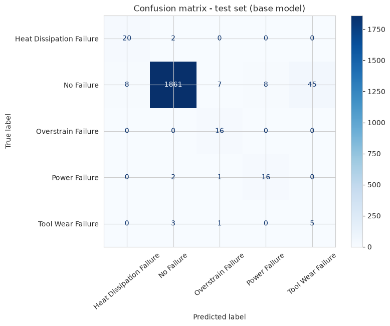

# Lab 1 - DNN / MLP with PyTorch (Regression and Multi-class Classification)

**Université Abdelmalek Essaadi - FST Tanger - Département Génie Informatique**
**Cycle Ingénieur : Logiciels et Systèmes Intelligents (LSI)**
**Module :** Deep Learning - **Pr. :** Lotfi ELAACHAK
**Student :** Mohamed Elgorrim

## Objective

Get familiar with PyTorch by building MLP (DNN) models for a **regression** task and a **multi-class classification** task, tuning them with `GridSearchCV` and testing some regularization techniques.

## Project structure

```
lab1/
├── notebooks/
│   ├── part1_regression_nyse.ipynb             # Part 1 : regression (NYSE)
│   └── part2_classification_maintenance.ipynb  # Part 2 : classification (predictive maintenance)
├── src/                                        # same code as .py scripts
├── images/                                     # plots used in this report
└── data/                                       # datasets (not pushed, see below)
```

## How to run

```bash
pip install torch scikit-learn skorch imbalanced-learn pandas matplotlib seaborn jupyter
# download the datasets from Kaggle into lab1/data/
kaggle datasets download -d dgawlik/nyse -p lab1/data/nyse --unzip
kaggle datasets download -d shivamb/machine-predictive-maintenance-classification -p lab1/data/maintenance --unzip
```

Then open the notebooks and run all cells. I ran everything on CPU. To use `GridSearchCV` with a PyTorch model I used **skorch**, which wraps a PyTorch module into an sklearn estimator.

---

## Part 1 : Regression (NYSE)

**Dataset:** prices of 501 S&P 500 companies from 2010 to 2016 (851k rows, no missing values).

### EDA

- `open`, `close`, `low` and `high` are almost 100% correlated. So predicting the close of the same day from these columns would be too easy (it's like cheating).
- I chose a more realistic task: **predict tomorrow's close price of Apple (AAPL) using the last 10 closing prices.**
- Train / test split is **in time order** (80% first days for train, 20% last days for test), because it's a time series. The scaler is fitted on train only.



### Model and GridSearch

MLP: `10 inputs -> hidden layers (Linear + ReLU) -> 1 output`, loss = MSE.
Grid tested (24 combinations, `TimeSeriesSplit` with 3 folds):

| Parameter | Values |
|---|---|
| hidden layers | (32), (64, 32), (128, 64, 32) |
| optimizer | Adam, SGD |
| learning rate | 0.01, 0.001 |
| epochs | 50, 100 |

**Best:** Adam, lr = 0.01, hidden = (64, 32), 100 epochs. Adam was in all the top results; SGD was too slow to converge in this number of epochs.

### Curves (Loss / Epochs and Accuracy / Epochs)

For regression there is no real "accuracy", so I used the **R² score** as accuracy (1 = perfect).



- Both losses go down, test loss stays a bit above train loss. It does not go up at the end, so there is no big overfitting.
- The curves have many spikes because lr = 0.01 is a bit high.
- Train R² ≈ 0.99, test R² around 0.9.



**Test result:** R² = 0.949, RMSE = 1.81 dollars.
But a naive model "tomorrow = today" gets RMSE = 1.68 dollars. So the network did not really learn to predict the market, it mostly copies the last price (the orange line is the blue one shifted by one day). This is normal: stock prices are very close to a random walk.

### Regularization

| Model | RMSE (dollars) | MAE | R² |
|---|---|---|---|
| **Base** | **1.81** | **1.31** | **0.949** |
| Dropout (0.2) | 3.46 | 2.98 | 0.812 |
| L2 / weight decay (1e-4) | 2.08 | 1.52 | 0.932 |
| BatchNorm | 1.90 | 1.43 | 0.943 |
| Early stopping (patience 10) | 1.94 | 1.41 | 0.941 |
| All combined | 2.44 | 1.90 | 0.907 |



- No regularization beat the base model. The model is small and doesn't overfit much, so there is nothing to fix.
- Dropout is the worst: it adds noise, and regression needs precise outputs.
- Early stopping gives almost the same score but stops at epoch 37 instead of 100.

---

## Part 2 : Multi-class classification (Predictive Maintenance)

**Dataset:** 10 000 machines with 5 sensor values (air temperature, process temperature, rotational speed, torque, tool wear) and a product type (L / M / H). Target = `Failure Type`.

### Pre-processing

- No missing values, no duplicates.
- Removed `UDI` and `Product ID` (just IDs).
- Found **27 inconsistent rows**: 9 rows with `Target = 1` but "No Failure", and the 18 "Random Failures" rows which all have `Target = 0`. I removed them, so 5 classes are left.
- Removed `Target` because it gives the answer (data leakage).
- Added 2 features that make physical sense: `temp_diff = process_temp - air_temp` and `power = torque × rotational speed`.
- One-hot encoding for `Type`, `LabelEncoder` for the classes, `StandardScaler` fitted on the train set only.
- Stratified split 80% / 20%.

### EDA

The dataset is **very imbalanced**: 96.7% "No Failure", and only 45 "Tool Wear Failure" rows.


The boxplots show clear rules: Tool Wear Failure when tool wear is high, Heat Dissipation when `temp_diff` is small, Power Failure when power is too low or too high, Overstrain with high torque and high tool wear.

### Data augmentation (SMOTE)

SMOTE creates new samples of the small classes by mixing a real sample with its neighbours of the same class. I applied it **only on the train set** (the test set stays real). Train went from 7 978 to 38 570 rows (7 714 per class).



### Model and GridSearch

MLP: `10 inputs -> hidden layers (Linear + ReLU) -> 5 outputs`, loss = CrossEntropy. Same grid as part 1 (epochs 30 / 60), scored with **macro F1** because accuracy is misleading here.

**Best:** Adam, lr = 0.001, hidden = (128, 64, 32), 60 epochs (CV macro F1 = 0.97).

### Curves



- Train loss goes to almost 0 and train accuracy to almost 100%.
- **Test loss goes down until epoch ~8 and then goes up again**: this is overfitting, the model memorizes the train data (and the synthetic samples).
- Test accuracy still stays around 96-97%, but this number is not very meaningful because always saying "No Failure" would also give ~97%.

### Metrics (base model)

| | Train | Test |
|---|---|---|
| Accuracy | 0.980 | 0.961 |
| Precision (macro) | 0.770 | 0.623 |
| Sensitivity / Recall (macro) | 0.996 | 0.854 |
| F1 (macro) | 0.830 | 0.695 |



- Good sensitivity: the model finds most real failures (16/16 Overstrain, 20/22 Heat Dissipation, 16/19 Power).
- Low precision: many false alarms, especially 45 normal machines predicted as "Tool Wear Failure".
- Tool Wear Failure is the hardest class (F1 = 0.17): only 45 real examples in the whole dataset.
- For maintenance, a false alarm is less bad than a missed failure, so this behaviour is acceptable.

### Regularization

| Model | Train F1 | Test accuracy | Test precision | Test recall | Test F1 |
|---|---|---|---|---|---|
| **Base** | 0.830 | 0.961 | 0.623 | 0.854 | **0.695** |
| Dropout (0.3) | 0.784 | 0.958 | 0.582 | 0.812 | 0.657 |
| L2 / weight decay (1e-3) | 0.735 | 0.947 | 0.564 | 0.869 | 0.653 |
| BatchNorm | 0.885 | **0.966** | 0.616 | 0.777 | 0.675 |
| Early stopping (patience 5) | 0.783 | 0.963 | 0.583 | 0.804 | 0.658 |
| All combined | 0.691 | 0.940 | 0.546 | 0.880 | 0.640 |


- All regularization techniques **fixed the overfitting of the loss**: their test loss stays around 0.15 while the base model goes up to 0.32.
- But none of them improved the test macro F1. BatchNorm is the closest and has the best accuracy.
- L2 and "All combined" find a bit more failures (higher recall) but make more false alarms.
- Early stopping stopped at epoch 14, close to the point where the base test loss was the lowest.
- The real limit here is the very small number of real failure examples, not the model.

**Note:** in both parts, early stopping watches the test set. A cleaner way would be to use a separate validation set. Also, in part 2 the GridSearch was done on the SMOTE data, so the validation folds contain synthetic samples (that's why CV F1 = 0.97 is much higher than test F1 = 0.69). Putting SMOTE inside an `imblearn` Pipeline would fix this.

---

## Synthesis - what I learned

- How to build an MLP in PyTorch with `nn.Module` and `nn.Sequential`, and how to write the training loop myself (forward, loss, `backward()`, `optimizer.step()`).
- How to use `GridSearchCV` with a PyTorch model thanks to **skorch**, and that the cross-validation must respect the data (time order for stock prices, stratified for imbalanced classes).
- **A good score is not always a good model.** In part 1, R² = 0.95 looks great but a simple "tomorrow = today" rule is better. In part 2, 96% accuracy means almost nothing when 97% of the data is one class. Always compare with a simple baseline and use the right metric (macro F1, recall, confusion matrix).
- How to avoid data leakage: split before scaling, fit the scaler on train only, apply SMOTE on train only, remove columns that give the answer.
- How to read Loss / Accuracy curves: spikes mean the learning rate is high, a test loss that goes up while the train loss goes down means overfitting.
- Regularization (Dropout, L2, BatchNorm, Early stopping) helps when the model overfits, but it does not always improve the final score. When the model is small or the problem is the data itself (too few examples), regularization can't fix it.
